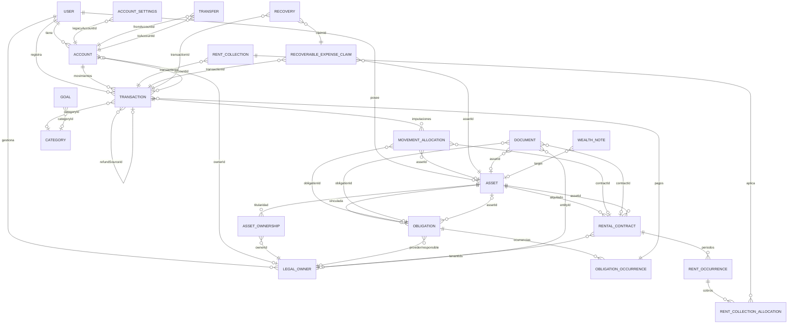
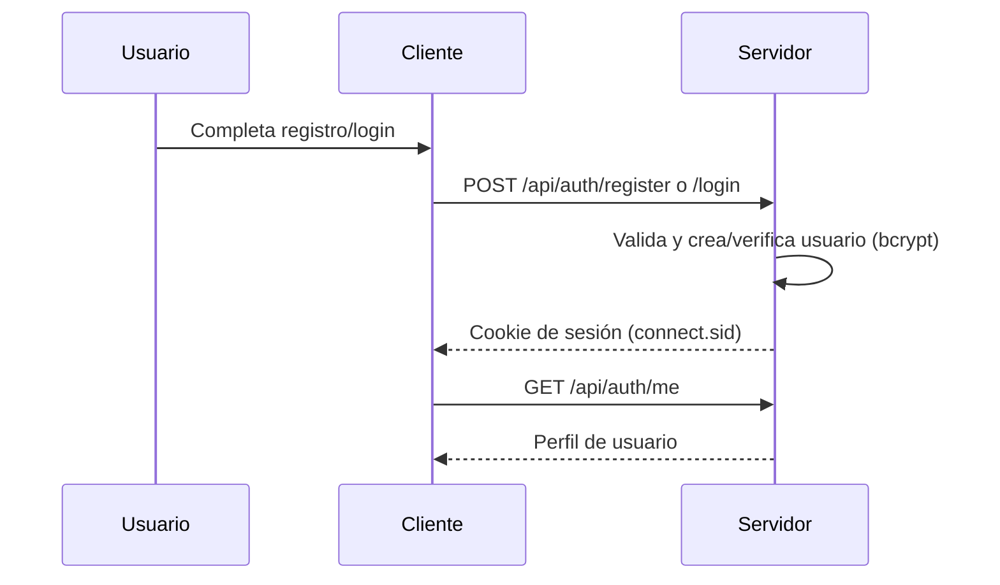
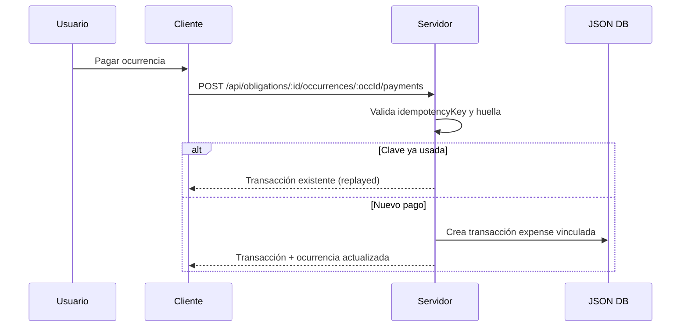

# SelimSystem — Especificación funcional

> Documento de especificación funcional de SelimSystem. Describe el comportamiento real del sistema a partir del código fuente. Idioma del documento: español profesional; identificadores y términos técnicos en inglés entre comillas invertidas.

## 1. Resumen ejecutivo

SelimSystem es una aplicación web progresiva (PWA) multiusuario para la gestión de finanzas personales y patrimoniales de una familia. Permite registrar ingresos, gastos y reembolsos, administrar cuentas por moneda, activos (bienes muebles e inmuebles), obligaciones recurrentes, contratos de alquiler y objetivos financieros, y analizar la evolución económica sin convertir monedas.

**Para quién:** personas que gestionan su patrimonio y el de su familia, con aislamiento total de datos entre usuarios.

**Principios de diseño:**

- **Sin conversión implícita de FX:** cada moneda se mantiene y reporta por separado; no existe tasa de cambio configurable ni conversión automática entre monedas.
- **Agrupación por moneda:** totales, resúmenes, tendencias y objetivos se calculan por `currencyCode`/`currency`, nunca mezclando monedas.
- **Una única verdad financiera:** los saldos de cuenta se derivan de movimientos `posted` (contabilizados) más saldos de apertura conciliados; las previsiones recurrentes no entran en totales hasta que se contabilizan.
- **Trazabilidad:** imputaciones (`movementAllocations`), reclamos recuperables y cobros de alquiler vinculan movimientos a activos, obligaciones y contratos.
- **Privacidad por usuario:** cada usuario tiene su propio directorio de datos y documentos en disco.

## 2. Arquitectura y despliegue

- **Stack:** Node.js 22, Express 4, base de datos JSON plana (`src/db/jsondb.js`), frontend SPA en JavaScript vanilla (`public/`), PWA instalable.
- **Persistencia:** archivos JSON por colección y por usuario bajo `DATA_DIR` (por defecto `./data`; en Fly.io `/data`). Escrituras atómicas (archivo `.tmp` + rename). Caché en memoria por proceso.
- **Sesiones durables:** `express-session` con `DurableSessionStore` (`src/services/durable-session-store.js`) que persiste sesiones en `sessions.json` bajo `DATA_DIR`, con TTL de 7 días, cookie `httpOnly`, `sameSite: 'lax'`, `secure` en producción.
- **Seguridad de transporte:** Helmet (sin CSP), CORS con origen `APP_URL` y credenciales, `trust proxy` habilitado.
- **Despliegue:** Fly.io, región `ams`, máquina compartida 1 CPU / 512 MB, volumen `selimsystem_data` montado en `/data`, `auto_stop_machines = "stop"` con `min_machines_running = 0`. Health check `GET /health` cada 30 s.
- **Endpoints públicos:** `GET /health` → `{ status: 'ok' }`; `GET /version.json` → `{ version }` (de `package.json`).
- **Autenticación por sesión:** todas las rutas `/api/*` excepto `/api/auth/*` requieren `req.session.userId` mediante `requireAuth`. El frontend envía cookies con `credentials: 'include'`.
- **Arranque:** `src/server.js` inicia el scheduler de alertas de cuentas (`account-alert-scheduler`) y cierra limpiamente con `SIGTERM`.

## 3. Modelo de datos

La base de datos es un conjunto de colecciones JSON. Las colecciones globales (sin `userId`) incluyen `users`; el resto se almacena por usuario en `<DATA_DIR>/<userId>/<collection>.json`. Cada entidad tiene `id` (UUID v4) y `createdAt` generados por `JsonDB.create`.

### Entidades principales

- **User:** `id`, `email`, `password` (bcrypt), `nombre`, `photo`, `resetToken`, `resetTokenExpires`, `createdAt`.
- **AccountSettings:** `id`, `appCurrency` (default `ARS`), `locale`, `timezone`, `alertLeadDays`, `forecastHorizonDays`, `dailyReview`, `legacyAccountId`, `lastAlertReviewDate`.
- **Account:** `id`, `nombre`, `currency`, `ownerId` (FK `legalOwners`), `primary`, `legacyPrimary`, `activo`, `archivedAt`, `order`, `presentation`, `openingBalanceMinor`, `openingDate`, `reconciled`, `reconciledAt`, `reconciliationEvidence`, `includedMovementIds`.
- **MigrationBackup:** `id` (`account-configuration-v1`), `state` (`active`/`rolling_back`/`rolled_back`), `collections` (snapshot de `transactions`, `categories`, `goals`), `transactionCount`, `checksum`.
- **Transaction:** `id`, `tipo` (`expense`/`income`/`refund`), `monto`, `amountMinor`, `accountId`, `currencyCode`, `incomeHolderId`/`incomeHolderName` (snapshot del titular), `titulo`, `categoryId`, `refundSourceId`, `paymentMethodId`, `paymentMethod`, `fecha`, `recurrente`, `frecuencia`, `fechaFin`, `clasificacion` (`A`/`B`/`Mixto` o `fijo`/`variable`), `montoA`, `montoB`, `ivaPorcentaje`, `comments`, `obligationId`, `obligationOccurrenceId`, `obligationIdempotencyKey`, `obligationPaymentFingerprint`, `paymentId`, `rentCollectionId`, `rentCollectionIdempotencyKey`, `recoverableClaimId`, `effectiveFromDate`.
- **Category:** `id`, `nombre`, `color`, `orden`, `parentId` (FK `categories`, un solo nivel).
- **Transfer:** `id`, `type`, `fromAccountId`, `toAccountId`, `fromCurrency`, `toCurrency`, `sentMinor`, `receivedMinor`, `feeMinor`, `feeCategoryId`, `fecha`, `status` (`posted`/`scheduled`), `postedAt`, `reference`, `normalizationAllocations`, `pendingAllocations`, `rateNumerator`, `rateDenominator`, `rateDirection`.
- **RecurringOccurrence:** `id`, `templateId` (FK `transactions`), `date`, `status` (`posted`/`scheduled`/`skipped`), `amountMinor`, `overrides`, `postedAt`.
- **RecurrenceRevision:** `id`, `templateId`, `effectiveFromDate`, `effectiveUntilDate`, `template` (snapshot).
- **AccountAlert:** `id`, `accountId`, `currency`, `date`, `title`, `neededMinor`, `plannedTransfer`, `coverageTransfers`, `itemId`, `status` (`open`/`covered`/`resolved`).
- **Asset:** `id`, `name`, `type` (`movable`/`immovable`), `description`, `subtype`, `details`, `propertyType`, `usageStatus`, `address`, `locality`, `province`, `country`, `area`, `acquisitionDate`, `acquisitionValue`, `status`, `notes`, `location`.
- **AssetOwnership:** `id`, `assetId` (FK `assets`), `ownerId` (FK `legalOwners`), `startDate`, `endDate`, `percentage`, `notes`.
- **AssetStatusHistory:** `id`, `assetId` (FK `assets`), `status`, `changedAt`, `notes`.
- **LegalOwner:** `id`, `name`, `kind` (`person`/`entity`), `roles` (`owner`/`tenant`/`provider`), `email`, `phone`, `address`, `taxIdentification`, `notes`.
- **Document:** `id`, exactamente uno de `assetId`/`entityId`/`obligationId`/`contractId`, `title`, `fileName`, `contentType`, `size`, `storageKey`, `uploadedAt`.
- **WealthNote:** `id`, `targetType` (`asset`/`entity`/`obligation`/`contract`/`rentOccurrence`/`rentCollection`), `targetId`, `date`, `content`, `author`.
- **Obligation:** `id`, `title`, `type`, `assetId`, `providerEntityId`, `responsibleEntityId`, `accountId`, `categoryId`, `paymentMethodId`, `currencyCode`, `estimatedAmount`, `paymentMethod`, `startDate`, `recurrenceFrequency`, `endDate`, `reminderLeadDays`, `notes`, `status` (`active`/`cancelled`), `effectiveFromDate`.
- **ObligationOccurrence:** `id`, `obligationId` (FK `obligations`), `date`, `status` (`expected`/`confirmed`/`paid`/`partial`/`overdue`/`cancelled`), `currencyCode`, `dueAmountMinor`, `estimatedAmount`, `title`, `categoryId`, `accountId`, `paymentMethod`, `paymentMethodId`, `notes`, `generationKey`, `confirmedAt`, `cancelledAt`.
- **ObligationRevision:** `id`, `obligationId`, `effectiveFromDate`, `effectiveUntilDate`, `definition` (snapshot).
- **RentalContract:** `id`, `assetId` (FK `assets`), `type`, `startDate`, `endDate`, `initialRent`, `initialRentMinor`, `currencyCode`, `periodicity`, `dueDay`, `depositAmount`, `depositMinor`, `guarantee`, `includedExpenses`, `expenseResponsibility`, `notes`, `documentId`, `status` (`draft`/`active`/`ended`/`cancelled`), `tenantIds` (FK `legalOwners`).
- **RentalCondition:** `id`, `contractId`, `effectiveDate`, `method` (`manual`/`percentage`/`index`), `rentMinor`, `rentAmount`, `adjustmentValue`, `indexValue`, `baseIndexValue`, `periodicity`, `previousConditionId`.
- **RentOccurrence:** `id`, `contractId`, `date`, `period`, `currencyCode`, `rentMinor`, `rentAmount`, `conditionId`, `generationKey`, `cancelled`, `cancelledAt`, `supersededByConditionId`, `generatedAt`.
- **RentCollection:** `id`, `transactionId` (FK `transactions`), `amountMinor`, `amount`, `currencyCode`, `accountId`, `date`, `method`, `paymentMethodId`, `idempotencyKey`, `fingerprint`.
- **RentCollectionAllocation:** `id`, `collectionId` (FK `rentCollections`), `occurrenceId` (FK `rentOccurrences`), `amountMinor`, `amount`, `currencyCode`, `idempotencyKey`, `fingerprint`.
- **MovementAllocation:** `id`, `transactionId` (FK `transactions`), `amountMinor`, `amount`, `currencyCode`, `assetId`, `obligationId`, `occurrenceId`, `contractId`, `rentOccurrenceId`, `complete`.
- **RecoverableExpenseClaim:** `id`, `transactionId` (FK `transactions`), `assetId`, `contractId`, `tenantEntityId`, `recoverableMinor`, `amount`, `currencyCode`.
- **Recovery:** `id`, `claimId`, `transactionId` (FK `transactions`), `amountMinor`, `amount`, `currencyCode`, `accountId`, `date`, `idempotencyKey`, `fingerprint`.
- **PaymentMethod:** `id`, `name`, `type`, `accountId`, `notes`, `lastFour`.

### Diagrama ER (Mermaid)

## 4. Dominio financiero

### 4.1 Cuentas y monedas

- Monedas soportadas por el sistema (`CURRENCIES`): amplio conjunto ISO; monedas seleccionables para cuentas y moneda principal: `ARS`, `EUR`, `USD`.
- Las cuentas (`Account`) tienen moneda inmutable una vez que existen movimientos, conciliación o saldo de apertura (`hasMovement`).
- Cada cuenta puede tener un titular legal (`ownerId`), orden de presentación y estado activo/archivado.
- Solo se puede archivar una cuenta no principal sin recurrencias ni transferencias programadas.
- Eliminación física solo de cuentas no principales sin movimientos.

### 4.2 Ingresos (A/B/Mixto, IVA)

- Los ingresos (`tipo: 'income'`) pueden clasificarse como `A`, `B` o `Mixto` (con `montoA` y `montoB` que suman el total).
- Ingresos sin clasificación se reportan como `B` (compatibilidad con registros antiguos).
- El IVA (`ivaPorcentaje`) solo aplica a la parte A (total para `A`, `montoA` para `Mixto`).
- `getIncomeBreakdown` y `getIncomeIva` (`src/utils/income.js`) implementan el desglose y el IVA con precisión de centavos.
- El titular del ingreso se captura como snapshot (`incomeHolderId`/`incomeHolderName`) al crear el movimiento, a partir del titular legal de la cuenta.

### 4.3 Gastos, reembolsos y transferencias

- Gastos (`tipo: 'expense'`) y reembolsos (`tipo: 'refund'`) requieren categoría.
- Los gastos se clasifican como `fijo` o `variable` (default `variable`).
- Los reembolsos no son gastos: reducen el gasto neto en analítica y pueden heredar la imputación del gasto de origen (`refundAllocations`).
- Las transferencias (`transfers`) mueven fondos entre cuentas, con importe enviado/recibido, comisión opcional y categoría de comisión. Entre misma moneda los importes deben coincidir; entre distintas monedas se exige importe recibido explícito (conversión manual, sin FX implícito).
- Estados de transferencia: `posted` (contabilizada) o `scheduled` (programada).

### 4.4 Tasas y conciliación de saldos

- Las transferencias guardan `rateNumerator`/`rateDenominator` y `rateDirection` como trazabilidad de la conversión manual.
- La conciliación de cuenta (`POST /api/accounts/:id/reconcile`) fija `openingBalanceMinor`, `openingDate` e `includedMovementIds` (movimientos anteriores a la fecha que se consideran ya incluidos).
- `getAccountBalances` calcula saldo verificado solo si `reconciled === true` y `openingBalanceMinor` no es nulo; de lo contrario `balanceStatus: 'needs_reconciliation'`.
- El saldo incluye movimientos `posted` (ingresos/reembolsos suman, gastos restan), ocurrencias recurrentes contabilizadas y transferencias `posted`.

### 4.5 Recurrencias y previsiones

- Las transacciones recurrentes (`recurrente` + `frecuencia`) generan instancias por mes (`generateRecurringInstances`, `getMonthTransactions`).
- Frecuencias: `monthly`, `bimonthly`, `quarterly`, `semiannual`, `annual`.
- Una ocurrencia se puede contabilizar (`POST .../occurrences/:date/post`), editar (`PUT`) o omitir (`DELETE` → `skipped`).
- Las ocurrencias `posted` generan filas en `recurringOccurrences` con `overrides` y `amountMinor`.
- Las previsiones recurrentes futuras no entran en totales de ingresos/gastos hasta que estén `posted` (o la fecha sea pasada para no recurrentes).

### 4.6 Imputaciones y reclamos recuperables

- `movementAllocations` imputa un movimiento a bienes, obligaciones, ocurrencias, contratos o períodos de alquiler, con importe parcial y flag `complete`.
- Las asignaciones validan moneda, titularidad y coherencia (bien vs obligación/contrato).
- `recoverableExpenseClaims` registra la parte recuperable de un gasto (p. ej. a un inquilino), con recuperaciones parciales (`recoveries`) que generan ingresos de tipo `income` vinculados al reclamo.
- `allocationsForTransaction` establece precedencia exclusiva: asignaciones genéricas → vínculo de obligación → cobro de alquiler → reclamo recuperable; los reembolsos heredan proporcionalmente la imputación del gasto de origen.

## 5. Activos (Bienes)

- Tipos: `movable` (mueble) e `immovable` (inmueble).
- Ficha de bien: nombre, descripción, estado (`status`), notas, ubicación; para muebles: subtipo y detalles (clave/valor, sin campos sensibles); para inmuebles: tipo de propiedad, estado de uso (`rented`, `family_home`, `own_use`, `vacant`, `renovation`, `own_commercial`, `other`), dirección, localidad, provincia, país, superficie.
- Titularidad compartida: `assetOwnerships` con `ownerId`, `startDate`, `endDate`, `percentage`, `notes`. Permite periodos de titularidad no solapados por titular.
- Historial de estados: `assetStatusHistory` registra cambios de `status`.
- Economía del bien: `GET /api/assets/:id/economics` calcula ingresos/gastos/reembolsos atribuidos por período (`acquisition`, `month`, `year`, `custom`, `contract`, `until-today`), evolución mensual acumulada, movimientos y pendientes (obligaciones y alquileres) atribuidos al bien.
- Documentos y notas fechadas pueden vincularse a un bien.

## 6. Obligaciones

- Una obligación es una serie recurrente o única de pagos (`obligations`), con titular/proveedor/responsable, cuenta habitual, categoría, moneda, importe estimado, frecuencia, fecha de inicio/fin, aviso anticipado y notas.
- Frecuencias de recurrencia: las mismas del dominio (`monthly`...`annual`) o única (`recurrenceFrequency: null`).
- Ocurrencias (`obligationOccurrences`) se generan bajo demanda por rango, con importe real (`dueAmountMinor`) editable por ocurrencia.
- Estados de ocurrencia: `expected`, `confirmed`, `partial`, `paid`, `overdue`, `cancelled`. El estado se deriva de pagos registrados y fecha actual.
- Pagos parciales: `POST .../occurrences/:id/payments` registra un gasto vinculado (`obligationOccurrenceId`), idempotente mediante `idempotencyKey` (hash) y huella del payload.
- Reversiones de serie: `obligationRevisions` permite cambiar la definición a partir de una fecha futura (`effectiveFromDate`), con validación de no retroactividad si hay pagos.
- Cancelación de obligación: marca la obligación y sus ocurrencias sin pago como `cancelled`.
- Alertas: `GET /api/obligations/alerts` lista ocurrencias vencidas o próximas dentro del aviso anticipado.

## 7. Analítica

- **Resumen mensual** (`GET /api/summary?month=YYYY-MM`): ingresos, ingresos A/B, porcentajes A/B, IVA acumulado, desglose por titular, gastos, reembolsos, gastos netos, ahorro, ingresos normalizados, fijos/variables, por categoría (jerárquico), metas y totales por moneda.
- **Ingresos normalizados:** `incomeByCurrency` suma ingresos originales y ajusta por transferencias de normalización (`normalizationAllocations`), sin convertir monedas.
- **Desglose por categoría:** gastos y reembolsos por categoría, con agregación de subcategorías en la categoría padre.
- **Fijo vs variable:** suma de gastos por `clasificacion`.
- **A vs B por titular:** `holderTotals` agrupa ingresos por titular legal (snapshot) y moneda, con porcentajes.
- **IVA mensual por titular:** `ivaByHolder` expone el IVA acumulado por titular.
- **Evolución mensual:** `GET /api/trends?from&to` entrega datos mensuales y tendencias por categoría.
- **Burn rate:** `GET /api/summary/burn-rate` compara el gasto acumulado del mes actual vs. promedio de N meses anteriores (1/3/6/12).
- **Objetivos:** metas de ahorro mensual, límite de gasto por categoría o gasto general, en modos monto fijo, porcentaje de salario o porcentaje dinámico de ingresos; progreso calculado sobre el mes.
- **Vista global por moneda:** `GET /api/finance/overview` entrega movimientos, transferencias y pendientes (obligaciones y alquileres) agrupados por moneda, sin conversión.
- **Forecast de cuenta:** `GET /api/accounts/:id/forecast` proyecta saldo mínimo en horizonte configurable, con alertas de cobertura.

## 8. Contactos / Titulares legales

- Entidad `legalOwners` con roles: `owner` (titular), `tenant` (inquilino), `provider` (proveedor). Una persona/organización puede tener varios roles.
- Campos de contacto: email, teléfono, dirección, identificación fiscal, notas.
- Se asignan a cuentas (`Account.ownerId`) y a bienes (`AssetOwnership.ownerId`).
- Impacto en A/B e IVA: el titular del ingreso se captura como snapshot en la transacción a partir del titular de la cuenta; la analítica agrupa ingresos por titular (`incomeHolder`).
- Los inquilinos se vinculan a contratos de alquiler (`tenantIds`) y a reclamos recuperables (`tenantEntityId`).
- Los proveedores se vinculan a obligaciones (`providerEntityId`).

## 9. Configuración

- Moneda principal (`appCurrency`): una de `ARS`/`EUR`/`USD`.
- Locale (`locale`) validado con `Intl.NumberFormat`.
- Timezone (`timezone`) validado con `Intl.DateTimeFormat`.
- Alertas: `alertLeadDays` (0-30), `forecastHorizonDays` (1-365), `dailyReview` (boolean).
- Setup de cuentas: `ensureSetup` crea la cuenta principal legacy y el backup de migración (`migrationBackups` con snapshot de transacciones/categorías/metas y checksum SHA-256).
- Rollback/reapply: `rollbackSetup` y `reapplySetup` permiten revertir o reaplicar la configuración multi-cuenta solo si no hay cuentas/transferencias/ocurrencias/avisos en uso y las preferencias no fueron personalizadas.
- Orden de cuentas: `PATCH /api/accounts/order`.
- Medios de pago (`paymentMethods`): nombre, tipo, cuenta vinculada, notas, últimos 4 dígitos (sin números completos).

## 10. Flujos principales

### 10.1 Registro e inicio de sesión

- Registro: `email`, `password` (≥6), `nombre` únicos; crea usuario y sesión.
- Login: por `nombre` y `password`.
- Logout: `POST /api/auth/logout` destruye sesión y limpia cookie.
- Recuperación de contraseña por email (requiere SMTP configurado).

### 10.2 Crear cuenta con titular

1. `POST /api/accounts` con `name`/`nombre`, `currency`, `ownerId`, `primary`, etc.
2. Valida titular legal con rol `owner`.
3. Crea cuenta no conciliada (`reconciled: false`).
4. Conciliación posterior mediante `POST /api/accounts/:id/reconcile`.

### 10.3 Registrar ingreso

1. `POST /api/transactions` con `tipo: 'income'`, `monto`, `accountId`, `clasificacion` (`A`/`B`/`Mixto`), `montoA`/`montoB` (si Mixto), `ivaPorcentaje`.
2. Valida que A+B sumen el total.
3. Captura snapshot del titular desde la cuenta.
4. Calcula `amountMinor` según moneda de la cuenta.

### 10.4 Registrar gasto

1. `POST /api/transactions` con `tipo: 'expense'`, `monto`, `categoryId`, `clasificacion` (`fijo`/`variable`).
2. Requiere categoría existente.
3. Impacta saldos y analítica.

### 10.5 Reembolso

1. `POST /api/transactions` con `tipo: 'refund'`, `categoryId`, `refundSourceId` (gasto de origen).
2. Valida que el origen sea un gasto real.
3. En analítica reduce el gasto neto; la imputación se hereda proporcionalmente si no hay asignaciones explícitas.

### 10.6 Transferencia

1. `POST /api/transfers` con cuentas origen/destino, importes, fecha, estado.
2. Valida monedas e importes; exige importe recibido en conversiones.
3. Opcionalmente registra asignaciones de normalización (`allocations`).
4. Contabilización posterior con `POST /api/transfers/:id/post`.

### 10.7 Pago de obligación

- Valida cuenta activa con moneda coincidente, categoría, importe ≤ pendiente, fecha no futura.
- Idempotencia por `idempotencyKey`.

### 10.8 Cobro de alquiler

1. `POST /api/rentals/collections` con importe, cuenta, fecha, asignaciones a períodos.
2. Crea transacción `income` vinculada (`rentCollectionId`) y `rentCollection`.
3. Asigna importes a `rentOccurrences` (`rentCollectionAllocations`).
4. Idempotencia por `idempotencyKey`.
5. Asignaciones adicionales posteriores vía `POST /api/rentals/collections/:id/allocations`.

### 10.9 Imputación

- `PUT /api/finance/transactions/:id/allocations` reemplaza las asignaciones de un movimiento.
- Valida destinos, monedas, importes ≤ total del movimiento.
- Flag `complete` exige cobertura total.

### 10.10 Reconciliación

- `POST /api/accounts/:id/reconcile` fija saldo de apertura, fecha y movimientos incluidos.
- Habilita cálculo de saldo verificado.

### 10.11 Logout / sesión

- `POST /api/auth/logout` destruye sesión; cookie `connect.sid` se limpia.
- Sesión expira a los 7 días; renovación por actividad (`rolling: true`).

## 11. Reglas de negocio clave

- **Sin conversión FX:** no se convierten montos entre monedas; cada moneda se reporta por separado.
- **Reembolsos no son gastos:** reducen el gasto neto y pueden heredar imputación del gasto de origen.
- **Previas recurrentes no entran en totales** hasta que estén `posted` (o su fecha sea pasada para no recurrentes).
- **Idempotencia** de pagos de obligaciones y cobros de alquiler mediante clave hash y huella del payload; replay devuelve el resultado original.
- **Snapshot de titular** en ingresos: `incomeHolderId`/`incomeHolderName` se fijan al crear el movimiento.
- **Monedas inmutables** tras movimientos, conciliación o saldo de apertura.
- **Validación de titularidad/ownership:** un bien vinculado a una obligación o contrato debe coincidir; las asignaciones validan moneda y titularidad.
- **Precedencia exclusiva de imputación:** asignaciones genéricas → obligación → alquiler → reclamo recuperable; ningún monto se imputa dos veces.
- **Transferencias entre misma moneda** exigen importes iguales; entre distintas monedas exigen importe recibido explícito.
- **Ocurrencias contabilizadas** son inmutables (no se editan ni eliminan); se corrigen con movimientos compensatorios.
- **Generación de ocurrencias** hasta 1200 por serie (límite de seguridad).
- **Documentos:** solo un destino por documento (bien/persona/obligación/contrato); tipos permitidos PDF/PNG/JPEG/WEBP/TXT con validación de magic bytes y tamaño ≤ 20 MiB.

## 12. Seguridad y privacidad

- **Autenticación:** bcrypt con 12 rondas; sesiones firmadas con `SESSION_SECRET` (obligatorio en producción).
- **Scoping por usuario:** cada colección se lee/escribe en `<DATA_DIR>/<userId>/`; `users.json` es global pero las consultas filtran por id.
- **Documentos privados:** almacenados bajo `DATA_DIR/<userId>/documents` con nombres aleatorios; servidos con `Content-Disposition`, `X-Content-Type-Options: nosniff`, CSP `sandbox`, sin caché.
- **Validación de archivos:** detección de tipo por magic bytes, bloqueo de binarios/ejecutables/HTML, extensión coherente, límite de 20 MiB.
- **Secretos:** configuración por variables de entorno (`.env`); no se versionan secretos. `SESSION_SECRET` falla en producción si no está definido.
- **Auditoría de dependencias:** el proyecto usa dependencias con avisos moderados conocidos (`qs`, Express) según el entorno; no bloquean operación.
- **Eliminación de cuenta:** `DELETE /api/auth/account` borra el usuario y su directorio completo de datos.

## 13. Limitaciones conocidas

- **Volumen único sin réplica:** un solo volumen Fly.io (`/data`); no hay replicación ni backup automático fuera del backup de migración.
- **Registro abierto:** no hay invitación ni verificación de email obligatoria.
- **SMTP no configurado por defecto:** la recuperación de contraseña depende de variables SMTP.
- **Avisos moderados de `qs`/Express:** pendientes de actualización.
- **Sin FX:** no hay conversión de monedas ni tasas configurables.
- **Vista previa de Office diferida:** los documentos solo soportan PDF, PNG, JPEG, WEBP y TXT.
- **Máquina con auto-stop:** puede haber arranque en frío en Fly.io (`min_machines_running = 0`).
- **Sin edición de ocurrencias contabilizadas:** requiere movimiento compensatorio.

## 14. Glosario

- **A / B:** partes del ingreso atribuidas a dos titulares (o ramas fiscales); A es la parte sujeta a IVA.
- **Mixto:** ingreso dividido en partes A y B.
- **IVA:** impuesto al valor agregado calculado sobre la parte A del ingreso.
- **Titular (legal owner):** persona u organización con rol `owner`, `tenant` o `provider`.
- **Imputación:** asignación de un importe de un movimiento a un bien, obligación, contrato o período de alquiler.
- **Neto:** gastos menos reembolsos.
- **Posted (contabilizado):** movimiento u ocurrencia incorporado a saldos y totales.
- **Scheduled (programado):** movimiento u ocurrencia futura no contabilizada.
- **Reembolso:** devolución que reduce el gasto neto, no un gasto nuevo.
- **Reclamo recuperable:** parte de un gasto que se espera recuperar de un tercero.
- **Normalización:** ajuste de ingresos por transferencias entre cuentas de distinta moneda, sin conversión FX.
- **Conciliación:** fijación de saldo de apertura y movimientos incluidos para habilitar saldo verificado.
- **Ocurrencia:** instancia concreta de una serie recurrente (obligación o alquiler).
- **Burn rate:** comparación del gasto acumulado del mes actual contra el promedio histórico.
`