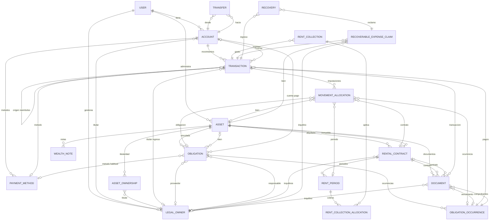

# SelimSystem — Especificación funcional

> Especificación funcional autoritativa de SelimSystem. Describe qué hace el sistema y cómo se comporta, sin decisiones de implementación. Idioma: español profesional y neutral; los identificadores de dominio se indican en inglés entre comillas invertidas cuando aportan claridad.

## 1. Propósito y alcance

SelimSystem es un sistema de administración financiera y patrimonial familiar, orientado al uso interno de un usuario principal (el padre de la familia). Su propósito es centralizar, en una única aplicación, la administración de cuentas, ingresos, gastos, bienes, alquileres, servicios, impuestos, comprobantes y vencimientos, eliminando la dispersión de planillas.

El sistema debe permitir administrar el patrimonio y las finanzas de la familia desde una sola aplicación. El usuario principal debe poder:

- Registrar y consultar cuentas bancarias.
- Registrar ingresos, gastos, reembolsos y transferencias.
- Administrar bienes muebles e inmuebles.
- Asignar titularidades a cuentas y bienes.
- Administrar alquileres, inquilinos, contratos y cobros.
- Administrar servicios, impuestos y otras obligaciones asociadas a cada bien.
- Registrar quién paga cada obligación: propietario, inquilino u otro responsable.
- Adjuntar y conservar comprobantes.
- Recibir avisos de vencimientos, cobros pendientes y documentos pendientes.
- Consultar el histórico económico de cada propiedad o vehículo.
- Ver un resumen global de ingresos, gastos y ahorro.

La aplicación debe distinguir claramente entre lo que ocurre en una propiedad y lo que ocurre en las finanzas generales de la familia.

## 2. Principios de diseño

- **Una única verdad financiera:** los totales se calculan a partir de movimientos contabilizados. Las previsiones futuras no alteran los totales hasta que se confirman.
- **Sin conversión de monedas:** cada moneda se mantiene y reporta por separado. El sistema no convierte ni mezcla monedas.
- **Trazabilidad:** cada movimiento puede imputarse a bienes, obligaciones, contratos y períodos de alquiler, vinculando el origen del dinero con su destino patrimonial.
- **Historial completo:** cada bien conserva su historial económico, contractual y documental.
- **Privacidad por usuario:** cada usuario tiene su propio espacio de datos y documentos.

## 3. Actores y roles

- **Usuario principal (padre):** administra el patrimonio y las finanzas de la familia. Es el único actor operativo del sistema en su uso interno.
- **Titulares (`LegalOwner`):** personas o sociedades que participan en la propiedad o administración de bienes y cuentas. Un titular puede cumplir distintos roles: propietario, inquilino, proveedor, responsable de pago u otro rol necesario. Una misma persona puede ser propietaria de un departamento e inquilina de otro; una sociedad puede ser propietaria de un local comercial y proveedora de servicios.

## 4. Dominio: titulares y bienes

### 4.1 Tipos de bienes

Existen únicamente dos tipos de bienes:

- **Inmuebles (`immovable`):** propiedades inmobiliarias, como casas, departamentos, terrenos, locales comerciales, oficinas u otros inmuebles.
- **Bienes muebles (`movable`):** objetos patrimoniales que pueden trasladarse, como vehículos, maquinaria, equipamiento u otros bienes.

No se obliga al usuario a elegir subtipos fijos como "vehículo", "maquinaria" o "equipamiento". El tipo de bien es simplemente inmueble o mueble. Los campos específicos de cada tipo se definirán en una iteración posterior, cuando se reciban los datos que el usuario considera necesarios registrar. Por ahora, la ficha de un bien debe permitir agregar la información que corresponda según su tipo, sin imponer campos obligatorios innecesarios.

Cada bien tiene una ficha propia, accesible desde la sección de Patrimonio, que concentra toda su información: datos generales, titulares, estado actual e historial de estados, documentos, notas, contratos de alquiler (si aplica), inquilinos, obligaciones asociadas, ingresos imputados, gastos imputados, reembolsos imputados, comprobantes, historial mensual de movimientos, vencimientos próximos y pendientes de cobro o pago.

### 4.2 Titulares

Los titulares son las personas o sociedades que participan en la propiedad o administración de los bienes y cuentas. Desde Configuración se deben poder crear, editar y administrar titulares. Cada titular debe poder asignarse a:

- Cuentas bancarias.
- Bienes muebles e inmuebles.
- Contratos de alquiler.
- Obligaciones.
- Transacciones.
- Documentos.
- Avisos.

### 4.3 Titularidad compartida

La titularidad de un bien puede ser exclusiva o compartida. Por ejemplo, un inmueble puede pertenecer íntegramente a la madre, a una sociedad, al padre, a un hermano o a una combinación de varias personas.

Cuando un bien tiene más de un titular, debe poder registrarse qué porcentaje o participación corresponde a cada uno, junto con el período de vigencia de esa titularidad (`startDate`, `endDate`, `percentage`). La titularidad compartida no debe solaparse indebidamente entre titulares del mismo bien.

## 5. Cuentas y métodos de pago

### 5.1 Cuentas

Las cuentas representan las cuentas bancarias y otros lugares donde se administra dinero. Cada cuenta debe tener:

- Nombre.
- Moneda.
- Titular.
- Saldo inicial o saldo conciliado.
- Movimientos asociados.
- Métodos de pago.
- Estado activa o archivada.

Un usuario puede tener tantas cuentas como necesite. Por ejemplo: cuenta bancaria del padre, de la madre, de una sociedad, en pesos, en dólares o en euros.

Cada cuenta debe poder asociarse a un titular. Así, cuando se registra un ingreso o un gasto, queda claro desde qué cuenta se movió el dinero y a quién pertenece esa cuenta. Las cuentas deben aparecer en la sección de Inicio, junto con sus saldos y movimientos.

### 5.2 Métodos de pago

Cada cuenta puede tener uno o varios métodos de pago asociados. Un método de pago representa la forma concreta en que se realiza un pago o un cobro desde una cuenta.

Ejemplos: tarjeta de débito, tarjeta de crédito, transferencia bancaria, débito automático, efectivo, billetera digital, cheque u otro.

No debe haber un límite de métodos de pago por cuenta. Por ejemplo, una misma cuenta bancaria puede tener asociadas una tarjeta de débito, una tarjeta de crédito y débitos automáticos.

Al registrar una transacción, el usuario debe poder indicar:

- Desde qué cuenta sale o entra el dinero.
- Con qué método de pago se realizó la operación.
- Si corresponde, cuántas cuotas se utilizaron.
- Si corresponde, qué interés se aplicó.

## 6. Transacciones

### 6.1 Tipos de transacción

Cada transacción es un movimiento financiero y puede ser:

- **Ingreso (`income`):** dinero que entra.
- **Gasto (`expense`):** dinero que sale.
- **Reembolso (`refund`):** devolución que reduce el gasto neto.
- **Transferencia (`transfer`):** movimiento de fondos entre cuentas.

Los ingresos, gastos y reembolsos se registran con monto, moneda (la de la cuenta), fecha, concepto y, cuando corresponde, categoría. Las transferencias mueven fondos entre cuentas y registran importe enviado y recibido, comisión opcional y categoría de comisión. Entre cuentas de la misma moneda los importes deben coincidir; entre distintas monedas se exige un importe recibido explícito, sin conversión automática.

### 6.2 Imputación de movimientos

Cada transacción puede ser:

- General.
- Imputada a uno o varios bienes.
- Imputada a una obligación.
- Imputada a un contrato de alquiler.
- Imputada a un período de alquiler.
- Imputada a un reclamo recuperable.

Esto permite distinguir, por ejemplo, un gasto general de la familia, un gasto de electricidad de un departamento, un gasto de seguro de un vehículo, un gasto de reparación de una casa alquilada, un ingreso de alquiler de un local comercial o un reembolso parcial de un gasto anterior.

Un mismo movimiento puede tener una imputación total o parcial. Por ejemplo, una reparación puede afectar en parte a una propiedad y en parte a un bien mueble, si corresponde.

La imputación no cambia el impacto global del movimiento: un gasto imputado a una propiedad también debe sumar al total de gastos de la tarjeta global de Inicio. Un ingreso de alquiler debe reflejarse tanto en el total global como en la ficha de la propiedad.

### 6.3 Gastos con tarjeta de crédito en cuotas

Cuando un gasto se paga con tarjeta de crédito, el sistema debe permitir registrarlo como una compra en cuotas. El usuario debe poder indicar:

- Fecha de la compra.
- Categoría.
- Concepto.
- Importe total.
- Moneda.
- Cuenta desde la que se paga.
- Método de pago: tarjeta de crédito.
- Cantidad de cuotas.
- Día del mes en que vence cada cuota.
- Porcentaje de interés, opcional.
- Comprobante, si lo tiene.
- Imputación a un bien, si corresponde.

Por ejemplo, si se compra un televisor por un importe determinado, se paga con la tarjeta de crédito de una cuenta bancaria, en 12 cuotas y con un interés del 7%, el sistema debe generar 12 cuotas futuras.

Cada cuota debe aparecer en la sección de transacciones en el mes que le corresponde, indicando claramente que es una cuota de esa compra. Las cuotas deben aparecer en los avisos antes de su vencimiento, pero no deben alterar los gastos ya efectivamente pagados hasta que se confirmen o contabilicen.

## 7. Inicio: ingresos, gastos y ahorro

La pantalla de Inicio debe mostrar tres indicadores principales:

- **Ingresos.**
- **Gastos.**
- **Ahorro.**

### 7.1 Ingresos

Deben sumarse todos los ingresos contabilizados, incluyendo:

- Alquileres cobrados.
- Ingresos laborales o comerciales.
- Recuperaciones de gastos.
- Reembolsos que el sistema clasifique como ingresos.
- Cualquier otro ingreso registrado.

### 7.2 Gastos

Deben sumarse todos los gastos contabilizados, incluyendo:

- Gastos generales.
- Gastos imputados a inmuebles.
- Gastos imputados a vehículos.
- Impuestos.
- Servicios.
- Reparaciones.
- Compras en cuotas ya vencidas o confirmadas.
- Cualquier otro gasto registrado.

### 7.3 Ahorro

El ahorro debe calcularse como:

Ahorro = Ingresos − Gastos

Estos tres indicadores deben poder mostrarse por moneda, porque el sistema no debe convertir ni mezclar monedas.

## 8. Patrimonio y ficha de bien

Cada bien debe tener una ficha propia, accesible desde la sección de Patrimonio. La ficha debe permitir ver y administrar toda la información relacionada con ese bien:

- Datos generales del bien.
- Titulares.
- Estado actual e historial de estados.
- Documentos.
- Notas.
- Contratos de alquiler, si aplica.
- Inquilinos.
- Obligaciones asociadas.
- Ingresos imputados.
- Gastos imputados.
- Reembolsos imputados.
- Comprobantes.
- Historial mensual de movimientos.
- Vencimientos próximos.
- Pendientes de cobro o pago.

La ficha debe permitir responder preguntas como:

- ¿Cuánto se cobró de alquiler este mes?
- ¿Cuánto se gastó en electricidad este año?
- ¿Qué impuestos están pendientes?
- ¿Qué comprobantes faltan recibir?
- ¿Quién pagó cada servicio?
- ¿Cuánto costó mantener esta propiedad durante el último año?
- ¿Qué obligaciones tiene este vehículo?
- ¿Cuándo vence el seguro?
- ¿Qué gastos tuvo este inmueble el mes pasado?

## 9. Alquileres

Cuando un inmueble está alquilado, debe poder registrarse un contrato de alquiler (`RentalContract`). El contrato debe permitir indicar:

- Inmueble alquilado.
- Inquilino o inquilinos.
- Fecha de inicio.
- Fecha de fin.
- Alquiler mensual inicial.
- Moneda.
- Día de vencimiento del alquiler.
- Depósito, si corresponde.
- Garantía, si corresponde.
- Servicios incluidos.
- Servicios a cargo del inquilino.
- Servicios a cargo del propietario.
- Documento del contrato.
- Estado del contrato.
- Notas.

El sistema debe poder generar períodos de alquiler según la periodicidad definida y mostrar si cada período fue cobrado, está pendiente o fue cancelado.

Cuando se recibe un pago de alquiler, debe poder registrarse como un ingreso vinculado al contrato, al inmueble y al período correspondiente.

## 10. Obligaciones

Una obligación (`Obligation`) es un compromiso recurrente o único asociado a un bien. Ejemplos:

- Electricidad.
- Agua.
- Gas.
- Internet.
- Impuesto municipal.
- Impuesto inmobiliario.
- Seguro.
- Patente.
- Verificación técnica.
- Expensas.
- Mantenimiento.
- Administración.
- Reparaciones.
- Otro.

Un mismo proveedor puede tener varias obligaciones. Por ejemplo, la empresa eléctrica puede ser un único proveedor, pero cada propiedad tiene su propio número de cliente, medidor o contrato.

Por eso, cada obligación debe poder identificar:

- Proveedor.
- Bien al que corresponde.
- Tipo de obligación.
- Número de cuenta, contrato, medidor, póliza, cliente u otro identificador.
- Moneda.
- Importe estimado.
- Frecuencia.
- Fecha o día de vencimiento.
- Cuenta desde la que se paga, si corresponde.
- Método de pago habitual.
- Categoría contable.
- Responsable del pago.
- Anticipación del aviso.
- Estado.
- Notas.
- Documentos.

Esto permite distinguir, por ejemplo, el impuesto municipal de una casa, de un terreno, de un departamento, de un local comercial y de un vehículo, aunque todos sean emitidos por el mismo organismo o proveedor.

Cada obligación genera ocurrencias (`ObligationOccurrence`) concretas con fecha, importe real editable y estado (`expected`, `confirmed`, `partial`, `paid`, `overdue`, `cancelled`).

## 11. Responsabilidad de pago

Cada obligación debe permitir definir quién debe afrontarla. Las opciones principales deben ser:

- Propietario.
- Inquilino.
- Compartida entre propietario e inquilino.
- Tercero.
- No aplica.

Cuando la responsabilidad es compartida, debe poder indicarse cómo se divide:

- Porcentaje para el propietario.
- Porcentaje para el inquilino.
- Importe fijo para cada parte.
- Otra regla acordada.

Esta definición debe poder depender del contrato de alquiler vigente. Por ejemplo:

- El inquilino paga electricidad.
- El propietario paga impuesto municipal.
- Las expensas se reparten al 50%.
- El propietario paga reparaciones estructurales.
- El inquilino paga reparaciones menores.

El sistema debe usar esta información para determinar qué avisos corresponden al propietario y cuáles requieren acción o comprobante del inquilino.

## 12. Avisos y anticipación

La sección de Avisos debe ser el centro operativo de la aplicación. Debe mostrar de forma clara todo lo que requiere atención. No debe limitarse a gastos vencidos. Debe incluir todos los eventos relevantes:

- Vencimientos próximos de servicios.
- Vencimientos próximos de impuestos.
- Vencimientos de seguros.
- Vencimientos de patentes.
- Vencimientos de verificaciones técnicas.
- Alquileres pendientes de cobro.
- Comprobantes pendientes de inquilinos.
- Obligaciones vencidas.
- Cuotas de tarjeta próximas a vencer.
- Contratos de alquiler próximos a vencer.
- Ajustes de alquiler próximos.
- Documentos pendientes.
- Obligaciones con pagos parciales.

### 12.1 Aviso de obligación del propietario

Ejemplo: "La electricidad del Departamento Palermo vence el 5 de diciembre. Importe estimado: $85.000. Faltan 4 días."

El aviso debe permitir acceder directamente a la obligación, registrar el pago, cambiar el importe real, adjuntar el comprobante y marcar la obligación como pagada.

### 12.2 Aviso de obligación del inquilino

Ejemplo: "El inquilino Juan Pérez debe enviar el comprobante de pago de electricidad del Departamento Palermo. Vence el 5 de diciembre."

Este aviso no representa necesariamente un gasto del propietario. Representa una obligación que el inquilino debe cumplir. El aviso debe permanecer abierto hasta que el propietario confirme el pago, adjunte el comprobante o marque la obligación como resuelta.

### 12.3 Aviso de alquiler pendiente

Ejemplo: "Falta cobrar el alquiler de noviembre del Departamento Palermo. Importe esperado: $900.000."

### 12.4 Aviso de cuota de tarjeta

Ejemplo: "En 5 días vence la cuota 3 de 12 del televisor comprado el 15 de noviembre. Importe: $107.000."

### 12.5 Aviso de documento pendiente

Ejemplo: "Falta adjuntar el comprobante de pago de electricidad de noviembre correspondiente al Departamento Palermo."

### 12.6 Anticipación de avisos

Para cada obligación, el usuario debe poder configurar con cuánta anticipación desea recibir el aviso. Por ejemplo:

- Electricidad: avisar 4 días antes del vencimiento.
- Impuesto municipal: avisar 15 días antes.
- Seguro del vehículo: avisar 30 días antes.
- Alquiler: avisar 3 días antes del vencimiento.
- Cuota de tarjeta: avisar 5 días antes.

El sistema debe respetar esa configuración por obligación y mostrar el aviso dentro de la sección de Avisos durante el período configurado.

## 13. Comprobantes

Cada obligación, cada período de alquiler y cada transacción deben poder tener comprobantes adjuntos. Ejemplos de comprobantes:

- Factura de electricidad.
- Comprobante de pago enviado por el inquilino.
- Recibo de expensas.
- Boleta de impuesto municipal.
- Comprobante de seguro.
- Certificado de verificación técnica.
- Factura de reparación.
- Contrato de alquiler.
- Recibo de alquiler.

Cada comprobante (`Document`) debe poder vincularse a:

- Un bien.
- Una obligación.
- Una ocurrencia o vencimiento concreto.
- Un contrato de alquiler.
- Un inquilino.
- Una transacción.

Esto permite que, al abrir la ficha de una propiedad, el usuario vea no solo los importes, sino también los documentos que respaldan cada pago, cobro o cumplimiento.

## 14. Flujos operativos

### 14.1 Obligación pagada por el inquilino

Ejemplo: la electricidad de un departamento debe pagarla el inquilino.

1. El sistema genera el vencimiento mensual de electricidad.
2. Detecta que la responsabilidad es del inquilino.
3. Crea un aviso indicando que falta el comprobante de pago.
4. El inquilino envía el comprobante al propietario.
5. El propietario entra a la ficha del inmueble.
6. Abre la obligación de electricidad.
7. Selecciona el vencimiento correspondiente.
8. Registra que fue pagado.
9. Adjunta el comprobante recibido.
10. El aviso deja de aparecer como pendiente.

En este caso, no necesariamente se registra una transacción financiera, porque el dinero puede no haber pasado por una cuenta del propietario. Pero sí debe quedar registrado:

- Qué obligación se cumplió.
- Qué inquilino la pagó.
- Qué período corresponde.
- Qué importe se pagó.
- Qué comprobante respalda el pago.
- Cuándo se resolvió.

### 14.2 Obligación pagada por el propietario

Ejemplo: el propietario paga el impuesto municipal de una casa.

1. El sistema genera el vencimiento del impuesto.
2. Detecta que la responsabilidad es del propietario.
3. Muestra un aviso antes del vencimiento.
4. El propietario registra el pago.
5. Indica la cuenta desde la que pagó.
6. Indica el método de pago.
7. Adjunta el comprobante.
8. El sistema registra el gasto.
9. El gasto se imputa a la propiedad.
10. El gasto también impacta en la tarjeta global de Gastos de Inicio.

### 14.3 Recuperación de un gasto

A veces el propietario paga un servicio que, según el contrato, corresponde al inquilino. En ese caso, el sistema debe permitir:

1. Registrar el gasto pagado por el propietario.
2. Imputarlo al inmueble y a la obligación correspondiente.
3. Marcar una parte o la totalidad como recuperable del inquilino.
4. Crear un reclamo recuperable (`RecoverableExpenseClaim`).
5. Registrar la recuperación cuando el inquilino reintegra el importe.
6. Vincular esa recuperación a un ingreso.
7. Adjuntar comprobantes de pago y recuperación.

Así se puede saber, por ejemplo, que el propietario adelantó una reparación o un servicio y luego recuperó parte o todo el importe del inquilino.

## 15. Ficha mensual de una propiedad

La ficha de una propiedad debe permitir visualizar mes a mes todo lo que ocurrió. Para cada mes debe mostrar:

- Alquiler esperado.
- Alquiler cobrado.
- Diferencia entre lo esperado y lo cobrado.
- Obligaciones con vencimiento.
- Responsable de cada obligación.
- Importe estimado.
- Importe real.
- Estado de cada obligación.
- Comprobantes recibidos.
- Gastos imputados.
- Ingresos imputados.
- Reembolsos.
- Reclamos recuperables.
- Recuperaciones.
- Notas y documentos.

Ejemplo de vista mensual:

| Concepto | Responsable | Esperado | Pagado o cobrado | Estado | Comprobante |
|---|---|---:|---:|---|---|
| Alquiler | Inquilino | $900.000 | $900.000 | Cobrado | Recibo |
| Electricidad | Inquilino | $85.000 | $85.000 | Pagado por inquilino | Factura |
| Impuesto municipal | Propietario | $40.000 | $40.000 | Pagado | Boleta |
| Expensas | Compartido | $150.000 | $150.000 | Pagado | Recibo |
| Reparación | Propietario | — | $75.000 | Pagado | Factura |

Esta vista debe permitir entender rápidamente la situación económica y operativa de cada propiedad.

## 16. Reglas de negocio esenciales

- Todo ingreso contabilizado debe sumar a la tarjeta global de Ingresos.
- Todo gasto contabilizado debe sumar a la tarjeta global de Gastos, aunque esté imputado a un bien.
- El ahorro global es la diferencia entre ingresos y gastos.
- Un gasto imputado a una propiedad también debe reflejarse en la ficha de esa propiedad.
- Un ingreso de alquiler debe reflejarse tanto en el total global como en la ficha de la propiedad.
- Un mismo proveedor puede tener múltiples obligaciones, una por cada bien.
- Cada obligación debe poder tener su propio número de cuenta, contrato, medidor, póliza o identificación.
- Cada obligación debe poder definir quién es el responsable de pagarla.
- Si la obligación es del inquilino, el sistema debe solicitar y registrar el comprobante de pago.
- Si la obligación es del propietario, el sistema debe permitir registrar el pago, la cuenta, el método y el comprobante.
- Las cuotas de tarjeta deben aparecer como compromisos futuros hasta que se confirmen o contabilicen.
- Los comprobantes deben poder adjuntarse a vencimientos concretos, no solamente a obligaciones genéricas.
- La ficha de cada bien debe mostrar el historial económico, contractual y documental completo.
- El sistema no debe convertir ni mezclar monedas.

## 17. Prioridad de funcionalidades

Para que la aplicación sea realmente útil para el usuario, estas son las capacidades centrales que debe cubrir:

1. Crear y administrar bienes muebles e inmuebles.
2. Asignar titulares a cuentas y bienes.
3. Crear cuentas bancarias y asociarles métodos de pago.
4. Registrar ingresos, gastos, reembolsos y transferencias.
5. Imputar movimientos a bienes, obligaciones, contratos y períodos de alquiler.
6. Crear obligaciones por proveedor y por bien.
7. Definir quién paga cada obligación.
8. Generar vencimientos y avisos con anticipación configurable.
9. Adjuntar comprobantes a cada vencimiento.
10. Registrar cobros de alquiler y vincularlos a períodos.
11. Registrar compras en cuotas con tarjeta de crédito.
12. Mostrar un panel de Inicio con ingresos, gastos, ahorro y acciones pendientes.
13. Mostrar una ficha completa por propiedad o vehículo.
14. Permitir consultar el histórico económico de cada bien.

La aplicación debe convertirse, en la práctica, en el lugar donde el usuario pueda abrir una propiedad y entender de inmediato: quién la tiene, quién la alquila, qué se cobró, qué se debe pagar, qué servicio vence, quién es responsable, qué comprobante falta y cuánto costó mantenerla.

## 18. Acceso y privacidad

El sistema está pensado para uso interno del usuario principal. Los datos y documentos de cada usuario se mantienen aislados: no se comparten entre usuarios. Los documentos respaldatorios se conservan vinculados a su bien, obligación, contrato, inquilino o transacción correspondiente.

## 19. Modelo de datos conceptual

El siguiente diagrama describe las entidades de dominio y sus relaciones, sin decisiones de implementación.

## 20. Glosario

- **Ahorro:** diferencia entre ingresos y gastos contabilizados.
- **Bien:** activo patrimonial, mueble o inmueble.
- **Comprobante:** documento que respalda un pago, cobro o cumplimiento.
- **Contabilizado (posted):** movimiento u ocurrencia incorporado a saldos y totales.
- **Cuota:** instancia futura de una compra en cuotas con tarjeta de crédito.
- **Imputación:** asignación de un importe de un movimiento a un bien, obligación, contrato o período de alquiler.
- **Inmueble:** propiedad inmobiliaria.
- **Mueble:** objeto patrimonial trasladable.
- **Obligación:** compromiso recurrente o único asociado a un bien.
- **Ocurrencia:** instancia concreta de una serie recurrente (obligación o alquiler).
- **Periodo de alquiler:** instancia generada de un contrato de alquiler.
- **Reclamo recuperable:** parte de un gasto que se espera recuperar de un tercero.
- **Recuperación:** reintegro de un reclamo recuperable, vinculado a un ingreso.
- **Reembolso:** devolución que reduce el gasto neto, no un gasto nuevo.
- **Responsable de pago:** quien debe afrontar una obligación.
- **Scheduled (programado):** movimiento u ocurrencia futura no contabilizada.
- **Titular (legal owner):** persona u organización con rol de propietario, inquilino, proveedor u otro.
- **Transacción:** movimiento financiero (ingreso, gasto, reembolso o transferencia).
- **Transferencia:** movimiento de fondos entre cuentas.
- **Vencimiento:** fecha en que una obligación debe cumplirse.
